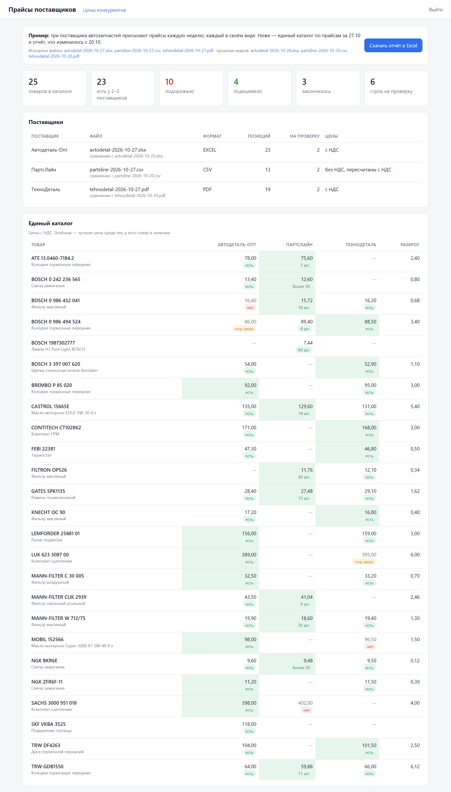
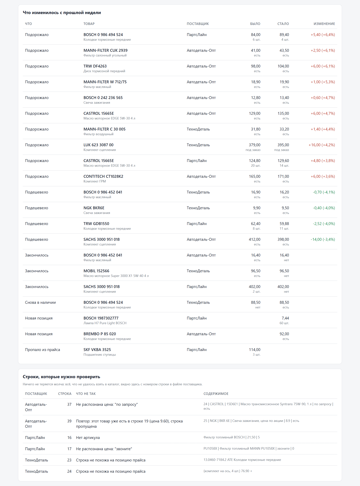

# Мониторинг цен конкурентов

Сервис раз в сутки (и по кнопке) проверяет цены и наличие товаров на сайтах конкурентов, хранит историю
и показывает, что изменилось: на сколько рублей и процентов, что закончилось, где сбор сломался.
Всё выгружается в Excel.


## Что умеет

- **Список товаров** по ссылкам: текущая цена, изменение к прошлой проверке (в рублях и %), наличие, время проверки.
- **История и график** цены за 30 дней по каждому товару.
- **Проверка по расписанию** (по умолчанию каждый день в 09:00) и вручную — по всем товарам или по одному.
- **Ошибки отдельно от «нет в наличии»**: если сайт не ответил или сменил вёрстку, это видно в кабинете,
  а последняя известная цена не теряется.
- **Выгрузка в Excel**: лист с текущими ценами и лист с историей проверок.
- **Кабинет под паролем** для одного администратора.

## Подключение нового сайта

Код менять не нужно: в `application.yml` добавляется профиль сайта — CSS-селекторы названия, цены и наличия.

```yaml
- code: shop
  host: shop.example.by
  name: "Магазин"
  name-selector: "h1"
  price-selector: ".product-price"
  availability-selector: ".stock-status"
  in-stock-pattern: "^В наличии"   # регулярное выражение по тексту блока наличия
```

Цена распознаётся в любом привычном виде: `1 299,00 руб.`, `£51.77`, `1,299.99 $`.

Сайты, которые подгружают цену скриптом после загрузки страницы, требуют headless-браузера (Playwright) —
это отдельная доработка под конкретный сайт.

## Прайсы поставщиков

Второй раздел кабинета сводит прайсы поставщиков в один каталог. Поставщики присылают файлы каждый в своём виде:
Excel с реквизитами над таблицей и группами товаров, CSV из 1С в Windows-1251 с ценами без НДС, PDF.
На выходе — Excel из четырёх листов:

- **Каталог**: по каждому товару цены всех поставщиков, лучшая цена среди тех, у кого товар в наличии, разброс цен.
- **Изменения**: что подорожало и подешевело с прошлого прайса (в рублях и %), что закончилось, снова появилось,
  добавилось, пропало.
- **Проблемы**: строки, которые не удалось взять в каталог (нет цены, нет артикула, повтор, строка PDF разорвана
  на две), с номером строки в файле поставщика. Молча ничего не теряется.
- **Сводка** по поставщикам.





Один товар узнаётся у разных поставщиков по бренду и артикулу. Из артикула убираются пробелы, дефисы, точки и косые
черты, а русские буквы, похожие на латинские, заменяются латинскими: в выгрузках из 1С «СUK2939» нередко набран
русской «С». Бренды сводятся по справочнику синонимов («MANN» и «MANN-FILTER», «FEBI BILSTEIN» и «FEBI») и ищутся
в названии, если отдельной колонки бренда нет. Цены без НДС пересчитываются в цены с НДС.

Новый поставщик подключается профилем в [`pricelist.yml`](src/main/resources/pricelist.yml): по какому имени файла
его узнать, формат, кодировка, названия колонок. Строка заголовков таблицы ищется сама, шапка над ней пропускается.
Для PDF задаётся регулярное выражение строки прайса.

```yaml
- code: partsline
  name: "ПартсЛайн"
  file-pattern: "(?i)partsline.*\\.csv"
  format: CSV
  charset: windows-1251
  prices-with-vat: false
  columns:
    article: ["Код"]
    name: ["Номенклатура"]
    price: ["Цена без НДС, руб."]
    stock: ["Остаток"]
```

Демо-прайсы трёх выдуманных поставщиков автозапчастей за две недели лежат в `src/main/resources/demo/pricelists`
(пересоздаются `DemoPriceListFiles` из тестов). Страница `/pricelists` показывает отчёт по ним; там же можно загрузить
свои файлы и сразу получить Excel. PDF поддерживается только с текстовым слоем, сканы требуют распознавания.

## Запуск

Нужен Docker.

1. Скопируйте `.env.example` в `.env`, задайте `ADMIN_PASSWORD` и `POSTGRES_PASSWORD`.
2. `docker compose up -d --build`
3. Откройте http://localhost:8080 и войдите.

В демо-режиме (`DEMO_MODE=true`) при первом запуске добавляются товары встроенного демо-магазина
с историей за 30 дней и несколько страниц [books.toscrape.com](https://books.toscrape.com) — песочницы,
созданной специально для тренировки парсинга.

## Для разработчиков

Java 21, Spring Boot 3.5, Spring Security, Thymeleaf, PostgreSQL, Liquibase, Jsoup, Apache POI, PDFBox.

- HTTP-запросы идут вне транзакций и по одному с паузой — без нагрузки на чужие сайты и без удержания соединений с БД.
- Каждая проверка сохраняется сразу: сбой на сотом товаре не теряет предыдущие.
- Защита от двойного запуска: расписание и кнопка «Проверить все» не пересекаются.
- Прайсы обрабатываются целиком в памяти, без базы: на вход файлы, на выход отчёт. Где хранить прошлые прайсы
  (папка, почта, база), решает обвязка под конкретного заказчика.
- Главная строится тремя запросами на любое число товаров (`DISTINCT ON` и `row_number()` в PostgreSQL), без N+1.

Тесты (нужен Docker для Testcontainers):

```bash
mvn test
```
